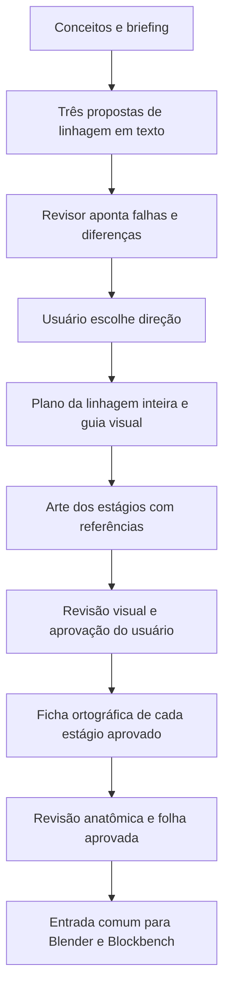

# Criar criaturas originais antes de modelar

Objetivo: receber duas ideias, criar identidade/história/linhagem e arte coerente,
aprovar o conceito e então produzir vistas para os fluxos Blender/Blockbench.
Este kit prepara briefing e prompts; não executa um gerador ou um treino pago.

**Restrições confirmadas:** até **R$ 50 uma única vez**, sem gasto mensal novo;
acessos existentes ao Gemini e a este chat; RTX 4050 Laptop com 6 GB de VRAM.
Não instalar nem iniciar pagamento/treinamento automaticamente. Usar as cotas
existentes dos geradores, com limites explícitos de tentativas.

## Fluxo proposto



Separar **criação** de **tradução**. Nesta etapa anterior à imagem canônica, o
criador pode inventar soluções a partir do briefing. Depois da aprovação, a arte
é a fonte de verdade: vistas e modelagem preservam a identidade, seguindo a skill
existente. A hipótese de direção artística não altera os contratos de modelagem.

## Dois papéis, uma pessoa dirigindo

O **criador** recebe briefing, exemplos escolhidos, guia visual e catálogo dos
personagens próprios. Propõe alternativas e explica a relação entre comportamento,
história, formas e poderes. Depois traduz a escolha em instruções de imagem.

O **revisor** recebe as mesmas restrições, a ficha canônica e a arte efetivamente
produzida. Em sua primeira avaliação, não recebe a defesa do criador. Precisa
indicar defeito observável, localização e correção de menor impacto. Uma justificativa
bonita não compensa um desenho que não mostra a ideia. Sem acesso à imagem, marcar
critérios visuais como **não avaliados**.

No piloto os papéis podem ser duas conversas separadas nos acessos já existentes.
Não é necessário contratar/operar dois agentes simultâneos. A comparação de
avaliações fica registrada; trocar a conversa não garante independência estatística.
Você aprova direção, arte e vistas. Pare após duas rodadas de revisão por etapa
ou quando houver impasse, em vez de gerar indefinidamente.

## Piloto de custo controlado

1. Escolher 6–10 linhagens de referência que você realmente admira. Quatro já
   foram estudadas seletivamente, sem eleger um cânone definitivo. Use referências
   por função e registre o que não quer repetir.
2. Escrever três propostas de texto para um par de conceitos. Elas devem diferir
   na ideia central, no arco e na silhueta, não só em nomes/cores. Escolher uma.
3. Planejar todos os estágios antes da primeira arte. Neste jogo, a raridade
   determina formas: Comum 1, Raro 2, Épico em diante 3. Quantidade ainda aberta
   pode ser `null` na exploração textual; confirmar antes da arte. Os quatro
   estágios das referências Miscrits não são obrigação.
4. Fazer a arte canônica dos estágios. Usar o estágio inicial e final para resolver
   a promessa visual; desenhar o estágio intermediário como transformação real.
   Manter as descrições de todos disponíveis e corrigir contradições.
5. Revisar e aprovar a família numa folha comparativa de até 768 px. Guardar os
   originais em resolução de trabalho; thumbnails são só para inspeção.
6. Só depois produzir a ficha de vistas de cada estágio. No piloto, completar
   primeiro um estágio para testar se a identidade sobrevive à mudança de ângulo.
7. Medir tentativas, falhas, tempo e preferência do usuário. Não declarar que
   o método dá originalidade ou coerência garantida antes desses testes.

Orçamento de trabalho inicial: três propostas de texto, uma arte por estágio,
no máximo duas revisões por etapa e uma ficha de vistas do estágio piloto.
É um limite de esforço, não uma previsão de custo/cotas do Gemini ou do chat.
Não chamar nenhum provedor pago automaticamente. O teto de R$ 50 é reserva para
um experimento futuro, não meta de gasto nesta etapa.

## O que uma criatura precisa ter

- Tese de uma frase: que experiência/característica só esta espécie oferece?
- Papel no mundo: habitat, comportamento e relação com outras criaturas.
- Uma contradição produtiva ou limitação: desejo/medo/custo que evita uma ficha
  genérica de “ser poderoso e proteger a floresta”.
- Integração dos conceitos na anatomia, rosto, pose, figurino e/ou armamento.
  Roupa, barba, adagas e ornamentos são recursos válidos; não proibi-los por
  princípio. Avaliar se formam um personagem específico e coeso, além de rótulos.
- Arco de evolução com causa: o que aprende/sofre/muda em cada estágio e como
  isso aparece no corpo, postura, comportamento e técnica de combate.
- Duas ou três âncoras visuais de família; uma transformação dominante por estágio.
- Paleta por papéis e proporções, contraste de valores e hierarquia de detalhes.
  Paleta distinta não exige que nenhuma cor apareça em outra espécie.
- Assinatura de movimento: maneira de respirar, andar, reagir e atacar.
- Arquétipo de combate obrigatório no briefing; mecanismo e limitações que se
  expressem no movimento. Animal/tema não fixam classe, e nenhuma hipótese de
  kit vira automaticamente regra do jogo.
- Lista do que evitar copiar e do que permanece incerto.

Manter um catálogo **dos originais próprios** com animal/plano de corpo, bioma,
tema, personalidade, paleta, motivo, arco e assinatura de movimento. Consultá-lo
antes de aprovar uma nova espécie. A checagem encontra repetições conhecidas;
não certifica originalidade absoluta contra toda obra existente.

## Turnaround para modelagem

Uma única arte em 3/4 não determina a anatomia escondida. Antes de gerar costas e
perfil, registrar contagem de membros, implantações, assimetrias, espessuras,
marcas e hipóteses para o que não aparece. Hipóteses relevantes precisam de decisão
de direção de arte, e então entram na ficha canônica.

Para cada estágio: conceito expressivo + frente real + perfil real + costas + 3/4;
adicionar topo apenas se resolver uma dúvida. Pés/base e escala alinhados nas vistas
técnicas, pose neutra que exponha juntas, sem perspectiva forte. Não misturar
estágios/referências de personagem ao pedir vistas do mesmo estágio.

Usar o [protocolo de modelagem](../../skills/criaturas-3d/SKILL.md)
e a skill instalada `turnaround-fiel-criaturas` para a ficha visual. Uma ficha gerada não é reconstrução
3D garantida nem prova de 360° consistente: revisar proporções, lados, apêndices,
oclusão e continuidade das marcas. Se falhar, corrigir as vistas; não deixar o
modelador inventar uma solução diferente em cada backend.

O pacote aprovado para modelar contém briefing, história, categorias/estágios,
artes canônicas, inventário anatômico, vistas aprovadas, paleta, escala e dúvidas
resolvidas. Só então seguir os pontos de categoria/folha do pipeline existente.

## LoRA: hipótese para uma segunda etapa

LoRA pode aprender regularidades visuais de um modelo compatível. História,
originalidade, arco evolutivo, coerência de catálogo e concordância entre ângulos
continuam precisando deste processo. O arquivo LoRA requer modelo base e ambiente
compatíveis; não é um estilo universal carregável em qualquer gerador.

Com 6 GB de VRAM, não descartar todas as técnicas locais, mas não tornar o piloto
dependente de treinar um modelo pesado. Isso exigiria escolher modelo, resolução,
quantização/offload, RAM e medir consumo/tempo na configuração real. Nada foi
instalado ou ensaiado localmente nesta sessão.

O piloto Sutruga mostrou falhas de **linguagem de formas, proporções e acabamento**,
além de decisões incorretas no prompt. Isso justifica estudar LoRA seriamente,
sem afirmar que treino é obrigatório ou que resolverá sozinho a direção artística.
O [plano atual](plano-lora-estilo.md) inclui inventário do catálogo, curadoria,
controle com/sem adaptador e orçamento completo antes de qualquer gasto.

Estimativa de referência, consultada em 05/11/2026:

| Item | Exemplo de referência | Limite da informação |
|---|---|---|
| Treino pequeno FLUX | guia Replicate: ~US$ 1,46 para cerca de 20 imagens/1000 passos | exemplo do provedor, não cotação de nosso dataset |
| Geração LoRA hospedada | página FLUX-dev-lora: US$ 0,032 por imagem | conferir preço/opções no dia da execução |
| Um treino + 20 saídas | US$ 2,10 pela soma acima | exclui câmbio, taxas, recarga mínima e retrabalho |
| Uso posterior | pago por geração nesse exemplo | gasto único de treino não torna inferência gratuita |

Não prometer que isso cabe em R$ 50 até conferir valor final da compra de créditos,
câmbio/taxas e mínimo de recarga. Crédito pré-pago e recarga automática são opções
distintas; para este orçamento não habilitar recarga automática. Nenhuma compra
ou autorização para compra foi feita.

Para um futuro treino de estilo: escolher temas e anatomias variados com acabamento
coerente; remover duplicatas/versões repetidas, separar estágio e conteúdo nas
legendas e manter famílias inteiras fora do treino para avaliação. Não despejar
todo o catálogo na tentativa de “aprender criatividade”. Não usar resultados da
avaliação para escolher treino e depois chamá-los de teste reservado.

Comparar sem treino e com LoRA usando conceitos inéditos, mesmo conjunto de
instruções e quantidade de tentativas. Rever consistência de estilo, fidelidade
ao briefing, variedade e semelhança excessiva com exemplos. Guardar o modelo sem
LoRA como controle. Planejar o custo de curadoria, treino e inferência separadamente.

O site público é referência de estudo. Antes de usar sua arte como dataset,
conferir permissão/termos para esse uso; não presumir licença por estar acessível.
Preferir consolidar linguagem própria e artes aprovadas com uso permitido. Também
conferir a licença do modelo/ambiente para uso no jogo.

## Usar o kit agora

```powershell
uv run python scripts/preparar-direcao-arte.py docs/direcao-arte/modelos/briefing-exemplo.json --saida modelos/_direcao-arte/piloto-01
```

Ler `01-criador.md` numa conversa; levar a proposta para outra com `02-revisor.md`.
Os outros prompts orientam arte e vistas após suas aprovações. Anexar as imagens
explicitamente: citar um caminho no prompt não dá acesso visual ao outro chat.
O script só prepara arquivos e hashes, sem instalação, rede ou cobrança.

Fontes e observações em [estudo Miscrits](estudo-miscrits.md), critérios em
[revisão](criterios-revisao.md). O kit é uma primeira versão de método; nenhuma
imagem nova ou linhagem original foi aprovada nesta sessão.

Curadoria posterior: [guia visual v0.1](guia-visual-v0.1.md) a partir das sete
escolhas do usuário; piloto atual [monge + tartaruga + rogue](pilotos/tartaruga-monge-rogue/propostas.md).
Direção escolhida: [Sutruga Mítico/três formas](pilotos/tartaruga-monge-rogue/ficha-sutruga-v1.md),
com primeiro conceito F3 [rejeitado pelo usuário](pilotos/tartaruga-monge-rogue/diagnostico-rejeicao-niojade.md).
Replanejar com Niojade como referência dominante e adagas solicitadas; a habilidade
final mantém a referência explícita no Ataque Alfa. Nenhuma arte está aprovada.

## Fontes técnicas consultadas

- [LoRA — Hugging Face Diffusers](https://huggingface.co/docs/diffusers/training/lora).
- [Guia de treinamento — Replicate](https://replicate.com/docs/get-started/fine-tune-with-flux).
- [Treinador e seleção de dados de estilo](https://replicate.com/replicate/fast-flux-trainer/readme).
- [Preço da inferência LoRA](https://replicate.com/black-forest-labs/flux-dev-lora).
- [Crédito pré-pago e recarga](https://replicate.com/docs/topics/billing/prepaid-credit).
