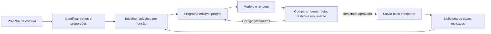

# Aprender a construir criaturas usando exemplos verificáveis

## O objetivo

Transformar uma prancha de criatura em um programa editável de volumes, planos, UV, pintura e articulações, usando soluções observadas em modelos refinados. A hipótese a testar é que recuperar e adaptar soluções **por função** melhora a qualidade frente à geração sem comparação. A generalização para qualquer criatura ainda não foi demonstrada.

O gabarito é o conjunto **conceito + render aprovado + construção + atlas**, não a igualdade literal de um JSON. Dois modeladores podem produzir resultados equivalentes com UUIDs, ordem de elementos, distribuição de UV e decomposições diferentes.

## O que realmente existe nesta máquina

Auditoria somente leitura do catálogo externo em 21/10/2026:

| Item | Quantidade/estado |
|---|---|
| Entradas indexadas | 525 |
| The Digimod | 522 |
| Cobblemon | 3: Goomy, Sliggoo e Goodra |
| Arquivo escolhido pelo catálogo | 461 projetos `.bbmodel`, 64 geometrias JSON |
| Projetos com textura embutida registrada | 460 |
| Entradas com dados de espécie | 270 |
| Estudo com ilustração/modelo explicitamente pareados | Koromon |
| Greninja, Ceruledge e Koraidon | Ausentes do catálogo local |

Os 525 registros não são 525 problemas independentes. Há quatro duplicatas extras por hash de arquivo e cerca de 499 assinaturas geométricas distintas numa comparação aproximada de caixas transformadas, normalizadas por altura/translação. Essa assinatura ignora textura, UV e inflate; não é uma deduplicação completa nem uma contagem de famílias.

Evidência local: `~/Downloads/referencias-criaturas/.catalogo-estrutural.json`, `the-digimod/indice-modelos.json`, `linhagem-goomy/fontes.json` e `estudos/koromon/estudo-koromon.md`. Os assets e estudos visuais continuam fora do repositório.

Temos matéria-prima útil para consulta, adaptação e avaliação. Ainda faltam ilustrações pareadas, correspondências de partes, landmarks revisados, famílias e partições de avaliação. Renders produzidos do próprio modelo permitem treino de reconstrução de renders; não cobrem sozinhos a tradução artística de uma ilustração para cubos.

## Método proposto

1. **Organizar casos.** Guardar fonte/versão, hash, ilustrações, câmeras dos renders, modelo, atlas, família e decisões observadas. Marcar dados ausentes. Normalizar cópias para inspeção, mantendo os originais.
2. **Decompor por função.** Separar corpo, mandíbula, rosto pintado, lâmina ornamental, chifre, asa articulada, mão, cauda etc. Um nome como `wing` é pista, não verdade semântica. Anotar se a solução depende de geometria, alfa, pintura ou movimento.
3. **Escolher correspondências.** A criatura inteira pode ter uma referência dominante; cada parte difícil pode ter outra. Explicitar o que a referência resolve e o que deve mudar conforme a prancha. Evitar colagens automáticas de partes incompatíveis.
4. **Gerar um programa parametrizado próprio.** Medidas relativas, conexões, simetria, número/função dos volumes, orientação dos planos, pivôs e capacidade de UV antecedem a pintura. A representação deve permitir alterar “largura da mandíbula” ou “abertura do ornamento” sem redesenhar tudo.
5. **Resolver geometria e textura conjuntamente.** Olhos grandes dependem de espaço no UV, continuidade nas laterais e contraste. A dimensão total do atlas não determina a legibilidade; é preciso medir o espaço de cada motivo e os texels por unidade.
6. **Renderizar, comparar, corrigir.** Mesma pose de repouso, orientação e enquadramento para vistas equivalentes; verificar frente, perfil, costas, 3/4 e cima quando necessário. Corrigir a causa do desvio e repetir. Comparar candidatos sob o mesmo orçamento de peças e tempo.
7. **Guardar o caso corrigido.** Registrar tentativa, diagnóstico, alteração, resultado e avaliação do usuário. Isso forma exemplos verificáveis para futuras consultas e, eventualmente, treinamento de componentes específicos.

O pipeline atual já possui parte da representação e o renderizador. O primeiro componente acrescentado é o diagnóstico de proporções/UV por partes. Recuperação visual, ajuste automático de parâmetros e avaliação de landmarks ainda precisam ser implementados e testados.



## Pavão/Koromon como primeiro caso de adaptação

O usuário estabeleceu Koromon como referência dominante para a construção do baby. A comparação anterior registrou contagens, mas deixou de preservar relações importantes:

| Aspecto | Construção observada no Koromon | Pavão v2 rejeitado |
|---|---|---|
| Corpo | Dois volumes; inferior avança e sustenta mandíbula/boca | Três volumes; base menor e recuada |
| Profundidade/largura corporal | Cerca de 0,917 | 0,75 |
| Olhos | Grandes, afastados, com continuação nas laterais | Menores proporcionalmente, mais próximos, só na frente |
| Apêndices | Faixas largas em planos complementares | Lâminas inclinadas lateralmente; uma quase de canto em 3/4 |
| Densidade | Cerca de 1 texel por unidade | Cerca de 2 texels por unidade |
| Gema do pavão | Detalhe próprio, a planejar | Motivo de 9 px de altura numa ilha de 5 px: cortado |

As posições oculares da referência foram estimadas visualmente pelo atlas; precisam ser anotadas para virar um teste numérico. O comparador não detecta olhos automaticamente.

A próxima reconstrução deve primeiro acertar a família de corpo/mandíbula, a ocupação facial e os planos complementares. O conceito do pavão define cor, gema, ocelos e a abertura das penas. O argumento “ainda está quadrado” não é critério suficiente: a referência escolhida também é cubificada. Acrescentar cubos ou resolução sem resolver essas relações repetiria a falha.

## Como verificar qualidade

| Critério | Medida/inspeção | Estado |
|---|---|---|
| Proporções por parte | Dimensões e centros relativos ao corpo | Implementado, caixas em repouso |
| Economia | Volumes e planos por papel | Implementado; não é nota isolada |
| Orientação dos planos | Soma das áreas projetadas frente/lado/cima | Implementado; ignora alfa e oclusão |
| Densidade e ocupação de UV | Densidade relativa, maior face frontal, alfa por face | Implementado para uma textura e UV explícito |
| Landmarks | Centros/caixas de olhos, boca, gema, raízes dos apêndices por vista | A anotar/implementar |
| Capacidade de motivos | Motivo cabe na ilha; dentes não fundem; continuidade nas bordas | Inspeção manual; verificação automática pendente |
| Silhueta e visibilidade | Máscaras por parte e câmeras alinhadas, incluindo 3/4 | Avaliação visual; métrica automática pendente |
| Movimento e montagem | Contato, pivôs, loops e efeito visível | Validadores existentes + inspeção de clipes |
| Arte | Expressão, identidade, leitura em tamanho de jogo | Avaliação visual do usuário/assistente, separada da integridade |

Máscaras da ilustração orientam anatomia e proporções, mas maximizar sua igualdade literal pode premiar dezenas de fatias. Para avaliar estilização, usar também simplificações aprovadas e exemplos de linguagem visual. Não somar essas medidas numa “nota de beleza” sem calibrá-la com avaliações humanas.

## Diagnóstico executável

```text
uv run criaturas comparar-referencias caso.json --saida comparacao.json
```

Formato mínimo do caso (caminhos relativos ao arquivo do caso ou absolutos):

```json
{
  "modo": "analogia",
  "ancora": "corpo",
  "referencia": {
    "arquivo": "referencia.bbmodel",
    "partes": {
      "corpo": {"tipo": "solido"},
      "ornamentos": {"tipo": "plano"}
    }
  },
  "candidato": {
    "arquivo": "candidato.bbmodel",
    "partes": {
      "corpo": {"tipo": "solido"},
      "ornamentos": {"tipo": "plano"}
    }
  }
}
```

`tipo` aceita `todos`, `solido` ou `plano`. `ossos: ["body"]` seleciona o osso e descendentes; `elementos: ["nome-ou-uuid"]` seleciona peças diretamente. Combinar filtros usa interseção. Nomes duplicados selecionam todas as ocorrências; para uma peça individual, use UUID. Corpo inteiro por `solido` só faz sentido num baby sem membros: em outras criaturas, forneça seleção explícita.

O relatório contém hashes, metadados e medidas agregadas, sem coordenadas, imagens ou animações copiadas. Exige os mesmos papéis nos dois modelos e registra `aprovacao_artistica: nao_avaliada`. `analogia` descreve adaptação entre criaturas; `reconstrucao` serve ao exercício de reproduzir uma espécie conhecida. O comando não garante que a tentativa foi feita sem consultar o gabarito: esse isolamento é parte do protocolo abaixo.

Caso real executado: `modelos/criatura-pavao/diagnostico-referencias/caso-koromon-v2.json`; relatório ao lado em `comparacao-koromon-v2.json`. O diagnóstico demonstra diferenças, não corrige o modelo nem prova melhoria de geração.

## O exercício do gabarito e a generalização

Separar dois usos:

- **Produção:** consultar referências próximas desde o início é desejável; mede qualidade de adaptação assistida.
- **Avaliação:** congelar a tentativa antes de revelar o modelo alvo. Guardar os inputs, hashes, biblioteca autorizada e resultado. Só depois comparar e registrar correções. Uma correção que já viu o alvo não entra como tentativa independente.

Começar com um piloto de 12 casos revisados, distribuídos entre baby, bípede, quadrúpede e apêndices difíceis. É uma escolha de escopo, não um número mínimo científico. Separar conjuntos para calibração do método e teste final; realizar comparação com a versão anterior sob o mesmo orçamento. Um alvo como Greninja só pode entrar quando seu modelo e ilustrações estiverem realmente disponíveis e registrados.

Agrupar recolors, exportações duplicadas, variantes e famílias próximas antes da divisão. Goomy/Sliggoo/Goodra ficam na mesma partição. No Digimod, usar a rede inteira de evoluções como família agrupa 269 criaturas numa componente: revisar famílias morfológicas em vez de adotar esse agrupamento cegamente.

Avaliar separadamente: reconstrução conhecida com alvo oculto; adaptação de estrutura conhecida; combinação nova de partes conhecidas; família estrutural ausente da consulta. Aprovar um recolor ou uma adaptação Koromon/pavão não comprova todos os outros casos.

## Treinamento: em que ponto entra

Há três níveis de trabalho diferentes:

1. **Memória externa e consulta:** fichas, catálogo por partes, exemplos e correções que o gerador pode ler. Já é útil com este acervo e não modifica pesos de uma rede.
2. **Ajuste de componentes especializados:** seleção de referências, proposição de proporções, detecção de landmarks ou ranking de candidatos. Exige dados anotados e teste separado; pode ser investigado após a linha de base.
3. **Treinar um gerador de imagem para modelo completo:** requer representação de saída consistente, diversidade, pares adequados, computação e avaliação de generalização. Não há evidência de que as 525 entradas atuais sejam suficientes. Tampouco existe um mínimo universal de exemplos que possamos afirmar aqui.

Consultar assets no chat não treina automaticamente o modelo de linguagem. O ganho persistente inicial vem dos programas, exemplos e avaliações salvos no projeto. Antes de preparar um dataset para treinamento externo, registrar também os termos de uso de cada fonte; acesso local e disponibilidade pública não especificam sozinhos usos permitidos.

## Pesquisa primária que sustenta a direção

- [ShapeAssembly, SIGGRAPH Asia 2020](https://rkjones4.github.io/shapeAssembly.html): demonstra programas de cuboides com conexões, simetria e hierarquia, aprendidos de estruturas existentes. Sustenta a escolha de uma representação editável por programa. Não resolve nossa pixel art nem prova tradução de criaturas.
- [Part Retrieval and Assembly, CVPR 2023](https://arxiv.org/abs/2303.01999): recupera partes de uma biblioteca e refina sua colocação iterativamente. Sustenta a ideia de composição por partes, num problema de entrada 3D; adaptá-la a conceitos desenhados continua sendo trabalho nosso.
- [nvdiffrast, NVIDIA](https://nvlabs.github.io/nvdiffrast/): oferece operações diferenciáveis de renderização para otimizar geometria/textura a partir de imagens. Aqui podemos começar com o renderizador existente e busca simples; não foi instalado nem integrado.
- [Objaverse-XL, 2023](https://arxiv.org/abs/2307.05663): relata mais de 10 milhões de objetos e experimento com mais de 100 milhões de renders para generalização em outra tarefa. Serve de contexto de escala, não de exigência mínima para o nosso problema especializado.

## Próximos aceites

- [x] Auditar acervo e distinguir assets de pares ilustração/modelo.
- [x] Implementar comparação agregada por partes e aplicá-la ao pavão rejeitado.
- [ ] Anotar landmarks e fichas de soluções em um piloto curado. (caso 1 feito: [[piloto-01-pavao-koromon]], nota 8,5)
- [ ] Gerar um candidato pavão que use a solução estrutural dominante e confrontá-lo com a v2 sob as mesmas câmeras.
- [ ] Executar tentativas com gabaritos ocultos e registrar resultados de casos reservados.
- [ ] Medir benefício antes de decidir treinar componentes ou ampliar o dataset.
