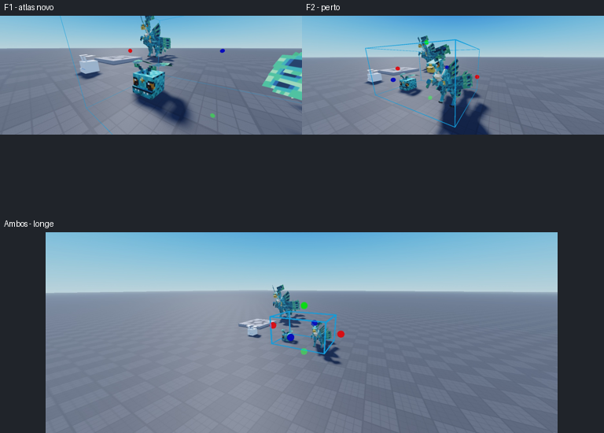

# Validação no cliente do Studio e material do F1

**Concluído:** F1 reimportado com o novo atlas, texturizado e preparado ao lado do F2. Capturas válidas
confirmaram o resultado perto e longe. Walks e hitboxes medidos no cliente; item 10.3 marcado no plano.
**Pedido ao usuário:** salvar o projeto do Studio para guardar os modelos e scripts preparados.
A publicação das animações para uso fora do Studio continua pendente; a prévia usa ids locais.

**Feito:**
- As importações novas estavam no Workspace, entre modelos antigos. Organizadas em
  `Workspace["criaturas modeladas blockbench"]`, com F1 em (24; 1,596; 10), F2 em (35; 4,139; 10), escala 3.
  Os modelos antigos fora da pasta foram preservados. Studio: `Template_95206881_AutoRecovery_0.rbxl`,
  id MCP `b5676c57-2fd5-44e2-92b1-376fb1fc236d`.
- Novos assets: F2 MeshId `120641951142067`, textura `123315715785564`.
  F1 MeshId `97293060483622`, textura `136950763430471` (deduplicados com a importação anterior).
- Correção adicional no preparo: o giro de importação afetava também o pivô do corpo do F2.
  Só desfazer a rotação deixava 3,27 studs de deslocamento. A compensação usa a posição de repouso
  de `InitialPoses.body_Original`, lida sem alteração, e só se aplica ao Bone diretamente sob a MeshPart.
- F1: o importador omitiu a Pose do `root` intermediário. O body estava ligado diretamente à Pose Raiz e não
  animava o Bone real. O preparo agora insere os ancestrais neutros conforme a hierarquia real dos Bones.
- Testes no cliente: walks tocando nas duas criaturas; F2 rotação máxima observada 4,658°,
  deslocamentos X/Z = 0, Y até 0,0834 stud, frente alinhada (dot mínimo 0,99595), hitbox sem movimento.
  F1 salto até 0,4633 stud, sem giro nem deslocamento lateral; hitbox estável.
  Todas as chaves corrigidas: 30 quadros F2 (giro até 4,689°) e 33 F1; X/Z nulos dentro da precisão numérica.
- O Play foi encerrado. Fixtures e alterações temporárias do cliente não persistem no Edit.

**Material branco:**
- F1 com SurfaceAppearance branco; sem SurfaceAppearance a textura apareceu colorida na captura do cliente.
  O asset contém pixels corretos; UVs da malha baixada foram inspecionadas e estão na faixa esperada.
- Trocar URL/reatribuir ColorMap, alternar o filtro e adicionar mapa de roughness nativo não resolveram.
  O mapa de roughness temporário foi removido. Não atribuir o resultado à moderação sem evidência.
- Testes posteriores de material gerado de EditableImage e troca temporária para o asset do F2 não puderam ser
  julgados: o MCP voltou a produzir capturas inteiramente brancas, inclusive com HUD. Não são prova do material.
  Os testes foram encerrados junto com o Play. Não foi acrescentado carregamento dinâmico ao jogo.
- Exportador suporta `material_pbr: true` (habilitado só no F1): acrescenta um PNG 4×4 constante de
  metallic/roughness ao GLB, para o importador montar SurfaceAppearance completo. Albedo 1024, UVs, skin,
  malha e animações são idênticos aos do GLB anterior, inclusive bytes originais do BIN.
  Hipótese a testar com a importação: evitar a conversão posterior de TextureID para ColorMap.
- F2 apareceu texturizado nas capturas do cliente. A inspeção visual final perto/longe de ambas permanece
  pendente; não prometer eliminação de mipmaps, do efeito de iluminação ou equivalência de escala por Bone.
  O Roblox não reproduz os canais de escala existentes no F1; salto e oscilação de walk foram medidos.

**Verificação:**
- `uv run pytest -q ferramenta/testes/test_exportar.py ferramenta/testes/test_roblox_regressoes.py`: 10 passaram.
- GLB F1 com material PBR: 96 triângulos, 18 nós, duas animações, zero erros/avisos Khronos.
- `ferramenta/testes/preparo-roblox.spec.luau`: executado no Studio substituindo o marcador `-- @PREPARO@`
  pelo código real do preparo. Fixtures fora do DataModel validam offset do F2, ancestral do F1, rotação,
  mapas/filtro, contenção da malha na caixa girada, repetição estável e preservação das sequências originais.
- Capturas reduzidas em `modelos/.roblox-trabalho/auditoria-20261022/`, sobretudo `f1-sem-sa-768.png`
  (F1 colorido), `f1-default-768.png` (branco com SA) e `studio-cliente-768.png` (F2 colorido).
- Fonte F2 permanece com SHA256 `57c04dc4274a88c1408fdc2d38c58c5aa8f0ea0bb0c972dc5841a0a2f4a4e736`.
  Alterações manuais da fonte/PNG e `docs/AURA*` ficam fora dos commits da IA.

**Próximo passo:** localizar o novo F1, preservar o anterior, aplicar o preparo vigente e testar no cliente.
Conferir os mapas PBR criados pelo importador e obter evidência visual perto/longe. A fase 10.3 continua aberta.

## Reimportação PBR e diagnóstico com o usuário

- F1 PBR importado e preparado; anterior preservado em
  `ServerStorage.HistoricoCriaturasBlockbench.Pavao_F1_antes_material_pbr`.
  O novo manteve MeshId `97293060483622` e ColorMap `136950763430471`.
  RoughnessMap `135530020828766`, MetalnessMap `118011954941645`: ambos imagens de 4×4,
  legíveis por EditableImage no Edit, embora PreloadAsync no cliente tenha retornado Failure nesses dois mapas.
  Isso não prova moderação nem explica sozinho o material branco.
- Walks medidos novamente no cliente: F1 Y entre −0,0108 e 0,4655 stud, rotação 0°, X/Z=0;
  F2 Y entre −0,0801 e 0,0815, rotação até 4,6635°, X/Z=0. Ambas as hitboxes ficaram imóveis e contiveram
  os oito cantos das MeshParts (excesso 0); uma faixa tocando por modelo e filtro Pixelated no cliente.
- Todas as capturas retornaram 99,6% de pixels brancos, incluindo cenário. O usuário confirmou que o F1
  continuava branco: o material completo sozinho não resolveu.
- Teste controlado no Edit: somente ColorMap do F1 foi trocado temporariamente para `123315715785564` (F2).
  O usuário confirmou **"Ganhou cores, com o desenho errado"**. Isso isola a falha ao caminho de material do
  mapa de cor `136950763430471`; o mesmo objeto F1 consegue mostrar outra textura. O mapa original foi
  restaurado e o atributo temporário de diagnóstico foi removido. Não é prova de corrupção interna do asset.
- Exportador: `espelhar_atlas: true` reorganiza a imagem por reflexão horizontal e troca U por 1−U,
  limitando a margem do codec a [0,1] conforme o sampler CLAMP_TO_EDGE. A imagem embutida e o PNG entregue
  são atualizados juntos; fonte artística e modelo original ficam intactos. Só habilitado no F1.
- Conferência do F1 real: 192 UVs de vértices mantêm exatamente a mesma amostra RGBA; todos os dados
  binários de posições, normais, índices, skin e animações permanecem iguais aos do GLB PBR anterior.
  Novo GLB: UVs entre 0,00024 e 1,0, 96 triângulos, duas animações, zero erros/avisos Khronos.
- Regressão acrescentada para o novo layout: testa UVs, amostragem, preservação dos outros accessors e
  igualdade do PNG embutido com o entregue. Suíte de exportação/regressões: **11 passaram**.
  O Play foi encerrado e F1/F2 foram enquadrados no Edit.
- Próxima importação deve criar outro asset de cor; verificar isso antes de fazer qualquer teste adicional
  de material. Não repetir a importação anterior com o mesmo ColorMap e tratá-la como nova textura.

## Resultado final — atlas novo validado

- Usuário importou o arquivo atualizado. Nova textura `84161190231240`, nova malha `135449839741592`.
  O F1 foi preparado em escala 3 e reposicionado em (24; 1,596; 10), na pasta combinada ao lado do F2.
  Revisão anterior preservada em `ServerStorage.HistoricoCriaturasBlockbench.Pavao_F1_pbr_atlas_antigo`.
- A captura voltou a funcionar: **F1 com a textura correta**, sem o branco do asset antigo.
  Conferidas também as vistas próximas do F2 e os dois de longe. Ambos mantêm Pixelated.
  A redução natural de detalhe a distância permanece; não há promessa de remover todos os mipmaps.
- Novo F1 medido no cliente por mais de um ciclo: uma faixa tocando, salto Y de −0,0133 a 0,4673 stud,
  rotação 0°, deslocamento lateral X/Z=0 e movimento da hitbox=0. Canais de escala por Bone continuam
  sendo uma limitação documentada do Roblox; não declarar igualdade de 100% de todos os canais.
- Hitboxes de ambos contêm os oito cantos das MeshParts (excesso 0), são PrimaryPart e colidem;
  as malhas não colidem. Frente e walk do F2 já medidos nas seções anteriores.
- Evidência persistida: `docs/sessoes/imagens/2026-10-23-roblox-final-768.png`.
  O Play foi encerrado; os dois modelos estão selecionados/enquadrados no Edit.
- Não houve alteração de código neste fechamento: mantidos os 11 testes de exportação/regressão já aprovados,
  mais a validação real da nova importação. Fase 10 continua aberta pelos demais itens e pelo piloto.

**Próximo passo após esta correção:** salvar o projeto no Studio; quando o usuário quiser usar no jogo publicado,
publicar as animações e registrar os ids. Para o pipeline artístico, continuar o piloto sem refazer os modelos salvos.
